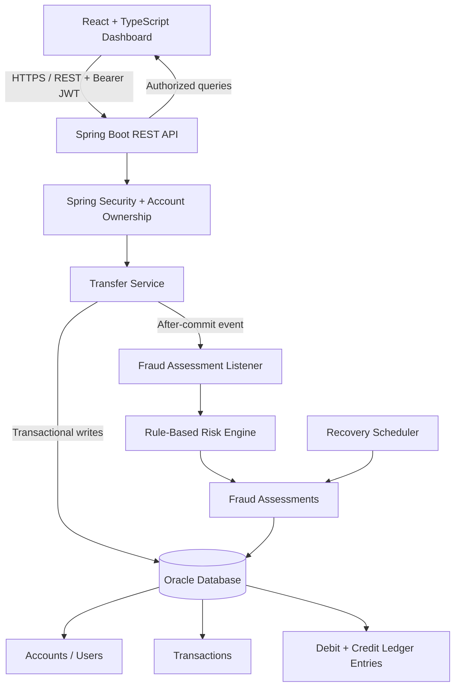

<div align="center">

# ORVENDIQ

### A Fintech Simulation Built Around Transaction Integrity, Access Control & Fraud Intelligence

**A full-stack financial transaction platform where moving money is only half the problem.**
The other half is making every transfer **accountable, authorized, traceable, and explainable**.

**Java 21 · Spring Boot · Oracle Database · React · TypeScript**

[Explore the Dashboard](#product-walkthrough) · [Engineering Deep Dive](#engineering-deep-dive) · [Architecture](#system-architecture) · [Run Locally](#getting-started)

</div>

---

## The engineering problem

A transfer interface is easy to prototype. Building the services *behind* it is more interesting: How do you prevent an unauthorized account transfer? How do you avoid partially recorded transactions? How do you reconstruct a balance from ledger entries? What happens when the fraud analysis fails **after** money movement has committed?

**Orvendiq is my attempt to solve those problems in one cohesive, testable application.** It connects a React dashboard to a Spring Boot REST API backed by Oracle, with an explicit financial ledger and a separate fraud-assessment workflow.

> **Scope:** This is a portfolio and educational simulation. It uses fictional demo accounts, does not move real money, and is not a production-ready banking or fraud-prevention system.

## Product walkthrough

<table>
<tr>
<td width="50%"><b>01 — Sign in</b><br/><sub>JWT-backed authentication and protected application access.</sub><br/><br/></td>
<td width="50%"><b>02 — Financial overview</b><br/><sub>Balances, recent activity and security insights in one workspace.</sub><br/><br/></td>
</tr>
<tr>
<td width="50%"><b>03 — Transfers</b><br/><sub>Account-to-account transfer flow with server-side validation.</sub><br/><br/></td>
<td width="50%"><b>04 — Transaction history</b><br/><sub>Track financial activity through the authenticated API.</sub><br/><br/></td>
</tr>
</table>

**05 — Fraud intelligence**
Risk assessments are surfaced as explainable indicators, not absolute verdicts.


## Engineering deep dive

### 1. A ledger, not just a mutable balance

Transfers are represented as financial transactions with corresponding **debit and credit ledger entries**. This provides an audit trail for balance reconstruction rather than relying solely on an account balance field.

**Transfer invariants modeled in Orvendiq:**

- A successful transfer records a matching debit and credit for the transfer amount.
- Transfer and ledger writes execute inside a database transaction boundary.
- Insufficient funds and invalid transfers are rejected before successful posting.
- Account balances can be derived from ledger activity and cross-checked for consistency.

**Why it matters:** A pretty transfer success message is not proof of financial correctness. The ledger is the part that makes a transfer traceable and auditable.

### 2. Authorization is enforced on the backend

Authentication proves who a user is; it does **not** automatically grant access to any account number supplied in an API request.

Orvendiq uses Spring Security, JWT authentication, BCrypt password hashing and account-ownership checks on protected operations. A `USER_ACCOUNTS` relationship maps authenticated users to their permitted accounts.

**Design principle:** The frontend is a client, not a security boundary. The backend verifies authorization independently of what the user interface allows.

### 3. Fraud assessment does not decide whether the ledger commits

The fraud engine evaluates transaction signals such as amount, frequency and recipient history to produce **LOW / MEDIUM / HIGH** risk indicators.

Rather than placing every fraud operation inside the critical financial write path, Orvendiq processes assessment events **after the transfer commits**. A recovery scheduler handles eligible transactions whose assessments have not yet been recorded, while uniqueness and idempotency checks help avoid duplicate assessments.

**Trade-off:** This design keeps the committed financial record separate from post-transaction analysis, but the dashboard may briefly show a transaction before its risk result is available. A fraud score is an investigative signal, **not** proof that a transaction is safe or fraudulent.

### 4. A dashboard connected to real backend workflows

The React + TypeScript interface integrates with REST endpoints for authentication, transfers, balances, transaction history and fraud results. It includes responsive layouts and interaction details using Tailwind CSS, GSAP, Motion and Lenis. Selected live panels periodically refresh their data rather than displaying static demo-only numbers.

## System architecture



<sub>The diagram describes component responsibilities and transaction/event boundaries; it is not a claim of distributed messaging infrastructure.</sub>

### A transfer, end to end

```text
Authenticated request
      |
      v
Verify source-account ownership
      |
      v
Validate recipient, amount and available funds
      |
      v
[Oracle transaction]
  Persist transfer
  Persist debit + credit ledger entries
[Commit]
      |
      +----> Return transfer result
      |
      +----> After-commit fraud assessment
                    |
                    +--> Persist risk classification
                    +--> Recovery path if assessment is missing
```

## Technology stack

| Layer | Technologies | Responsibility |
|:--|:--|:--|
| Backend | Java 21, Spring Boot, Spring Security | Business rules, REST APIs, authentication and authorization |
| Persistence | Oracle Database Free, Spring Data JPA, Hibernate, JDBC | Accounts, transaction records, ledger entries and risk assessments |
| Frontend | React, TypeScript, Vite, Tailwind CSS | Dashboard and API-driven financial workflows |
| Experience | GSAP, Motion, Lenis | Interface transitions and smooth scrolling |
| Testing | JUnit 5, Mockito | Risk-engine, service and integration test coverage |
| Local infrastructure | Docker | Oracle development environment |

## API surface

| Method | Endpoint | Purpose |
|:--|:--|:--|
| `POST` | `/api/v1/auth/login` | Authenticate and obtain access token |
| `POST` | `/api/v1/transfers` | Submit an authorized transfer |
| `GET` | `/api/v1/transactions` | Retrieve transaction history |
| `GET` | `/api/v1/accounts/{accountNumber}/balance` | Read account balance |
| `GET` | `/api/v1/fraud/assessments/{id}` | Read a fraud risk assessment |
| `GET` | `/api/v1/system/status` | Inspect application status |

Access to business endpoints is subject to JWT authentication and account-level permissions. See [backend documentation](backend/README.md) for more details.

## Testing and failure scenarios

The project contains unit and integration tests targeting financial and security behavior, including:

- Risk classification rules and threshold boundaries.
- Transfer authorization and account ownership.
- Insufficient-funds behavior and transaction posting.
- Double-entry ledger consistency checks.
- Fraud assessment idempotency and recovery scenarios.
- Transaction concurrency and duplicate-transfer scenarios.

**Important distinction:** These are areas represented in the test suite, not a claim that every test passes in every environment. Oracle-backed integration tests require a dedicated test database and may change data. Avoid running them against a demo database you want to preserve.

Run selected fraud tests:

```powershell
cd backend
.\mvnw.cmd "-Dtest=FraudRiskEngineTest,FraudRiskBoundaryTest,TransferFraudListenerTest" test
```

## Getting started

**Prerequisites:** Java 21, Node.js/npm, Oracle Database Free, and an initialized application schema. Docker can be used to run the local Oracle instance.

**1. Configure backend credentials locally.** The application expects environment variables such as:

```text
ORVENDIQ_DB_PASSWORD
ORVENDIQ_JWT_SECRET
```

Configure the database host, service/PDB and application user according to `backend/src/main/resources/application.yaml`. Do **not** commit passwords, JWT secrets, real user information or database exports.

**2. Start the API (PowerShell):**

```powershell
cd backend
.\mvnw.cmd spring-boot:run
```

**3. Start the dashboard in another terminal:**

```powershell
cd frontend
npm install
npm run dev
```

The Vite development interface is typically available at `http://localhost:5173`, with API requests proxied to the running backend by the local Vite configuration.

**Production builds:**

```powershell
# From backend/
.\mvnw.cmd clean package -DskipTests

# From frontend/
npm run build
```

For more setup and feature details, see the [backend README](backend/README.md) and [frontend README](frontend/README.md).

## Repository structure

```text
Orvendiq/
├── backend/            # Java / Spring Boot services and tests
├── frontend/           # React / TypeScript application
├── docs/
│   └── screenshots/   # Product walkthrough images
├── .gitignore
└── README.md
```

## What this project demonstrates

Orvendiq was built to practice the engineering challenges behind transaction-oriented products: **database consistency, secure account access, asynchronous side effects, domain modeling, automated testing and full-stack integration**.

The aim is not to imitate the scale or certification of a bank; it is to show how I reason about correctness and failure modes while delivering a working end-to-end product.

## Limitations and next steps

- **Not production banking software:** no real-money transfers or licensed financial integrations.
- **Rule-based fraud detection:** heuristic signals are not a validated machine-learning fraud model.
- **Local-first deployment:** reproducible provisioning and automated CI/CD are possible future improvements.
- **Security hardening:** broader threat modeling, deployment secrets management, rate limiting and operational monitoring would be needed for production use.

---

<div align="center">

### Built by Dwi Nisyatul Wardah

**Information Technology Graduate · Full-Stack & Backend Development**

[GitHub Profile](https://github.com/dnwardah-dev) · [Browse Backend](backend/) · [Browse Frontend](frontend/)

<sub>Orvendiq is an educational fintech simulation. All demo financial data is fictional.</sub>

</div>
