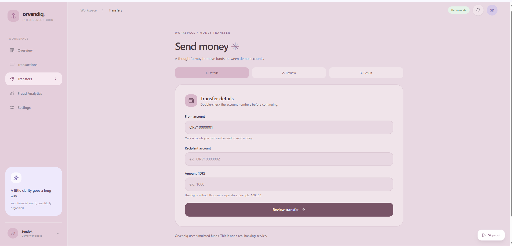
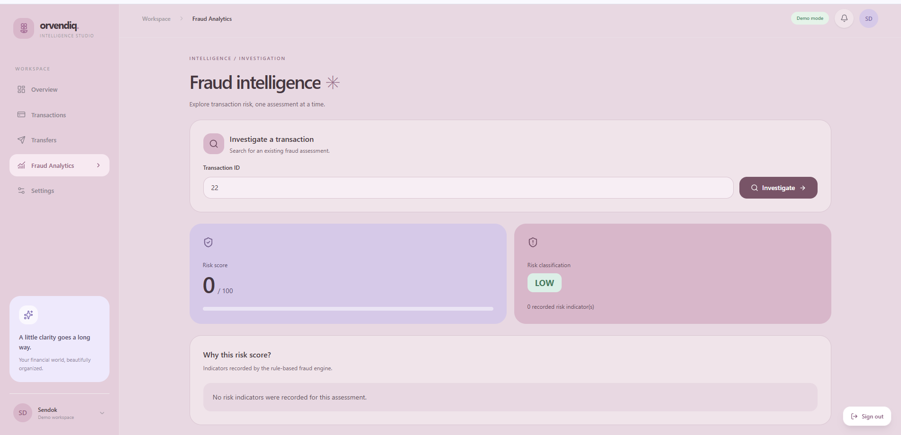

# Orvendiq
### Full-Stack Fintech Transaction & Fraud Monitoring Platform

Orvendiq is a full-stack fintech simulation built with
Java Spring Boot, Oracle Database, React, and TypeScript.

The application demonstrates secure financial transaction
processing, double-entry ledger accounting, account-level
authorization, and rule-based fraud risk monitoring through
an interactive dashboard.

> Portfolio project only. No real money is processed.

## Highlights

- JWT authentication with Spring Security
- BCrypt password hashing
- Account ownership authorization
- Account-to-account transfer processing
- Double-entry debit and credit ledger
- Transaction history and balance tracking
- Rule-based fraud risk assessment
- Post-commit fraud processing and recovery
- Responsive dashboard with interactive visualizations
- React, TypeScript, GSAP, Motion, and Lenis

## Technology Stack

**Backend:** Java 21, Spring Boot, Spring Security,
Spring Data JPA, Maven, JUnit, Mockito

**Database:** Oracle Database Free, SQL

**Frontend:** React, TypeScript, Vite, Tailwind CSS,
GSAP, Motion, Lenis

**Infrastructure:** Docker

## Repository Structure

    Orvendiq/
    |-- backend/
    |   |-- src/
    |   |-- pom.xml
    |   `-- README.md
    |-- frontend/
    |   |-- src/
    |   |-- package.json
    |   `-- README.md
    |-- .gitignore
    `-- README.md

## System Architecture

    React Dashboard
          |
          | REST API / JWT
          v
    Spring Boot Backend
          |
          +-- Authentication & Authorization
          +-- Transfer Processing
          +-- Double-Entry Ledger
          +-- Fraud Risk Assessment
          |
          v
    Oracle Database

## Main API Endpoints

| Method | Endpoint | Purpose |
|---|---|---|
| POST | /api/v1/auth/login | Authentication |
| POST | /api/v1/transfers | Money transfer simulation |
| GET | /api/v1/transactions | Transaction history |
| GET | /api/v1/accounts/{accountNumber}/balance | Account balance |
| GET | /api/v1/fraud/assessments/{id} | Fraud assessment |
| GET | /api/v1/system/status | System status |

Protected endpoints require appropriate authentication
and authorization.

## Getting Started

### Backend

Requirements:
- Java 21
- Oracle Database Free
- Configured application database

Set the required environment variables:

- ORVENDIQ_DB_PASSWORD
- ORVENDIQ_JWT_SECRET

Start the backend:

    cd backend
    .\mvnw.cmd spring-boot:run

### Frontend

Requirements:
- Node.js and npm
- Running Spring Boot backend

Install dependencies and start Vite:

    cd frontend
    npm install
    npm run dev

Development frontend URL:

http://localhost:5173

## Testing

Selected fraud unit tests:

    cd backend
    .\mvnw.cmd "-Dtest=FraudRiskEngineTest,FraudRiskBoundaryTest,TransferFraudListenerTest" test

Database integration tests require careful setup
and may modify local demo data.

## Security & Scope

Orvendiq demonstrates authentication, authorization,
transaction consistency, and fraud monitoring concepts.

It is not a licensed financial service or production
banking platform. Fraud scores are informational and
do not guarantee transaction safety.

Never commit passwords, JWT secrets, database files,
or real personal financial information.

## Documentation

- [Backend Documentation](backend/README.md)
- [Frontend Documentation](frontend/README.md)

## Author

Dwi Nisyatul Wardah

Information Technology Graduate

GitHub: https://github.com/dnwardah-dev

---

## Application Preview

Explore Orvendiq's full-stack fintech experience, from secure
authentication to financial transactions and fraud monitoring.

<!-- ORVENDIQ SCREENSHOT GALLERY -->

### Login

### Overview Dashboard

### Money Transfers

### Transaction History

### Fraud Analytics

---
