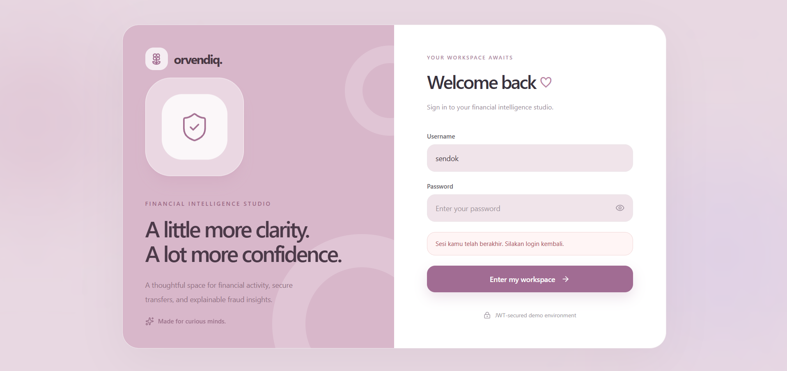
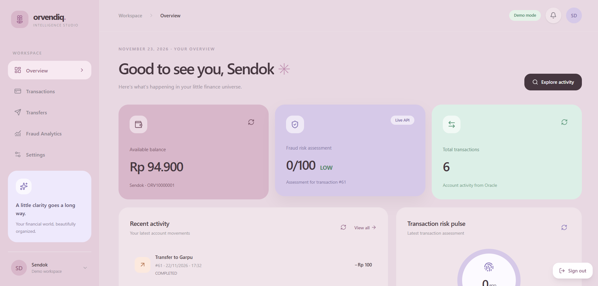
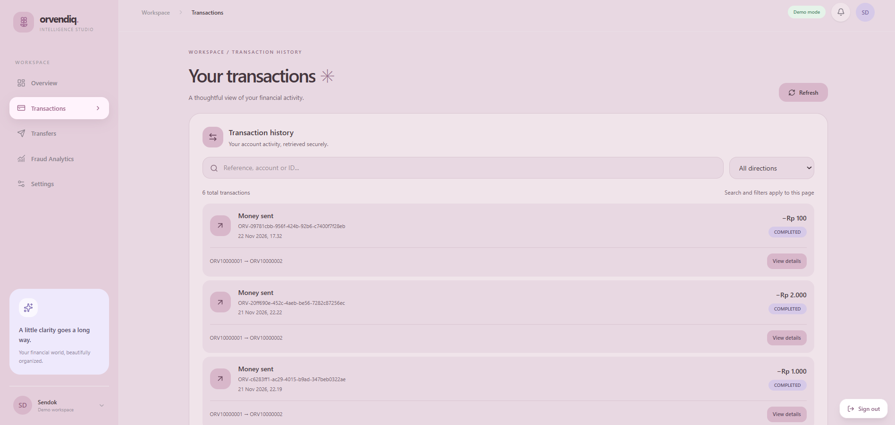
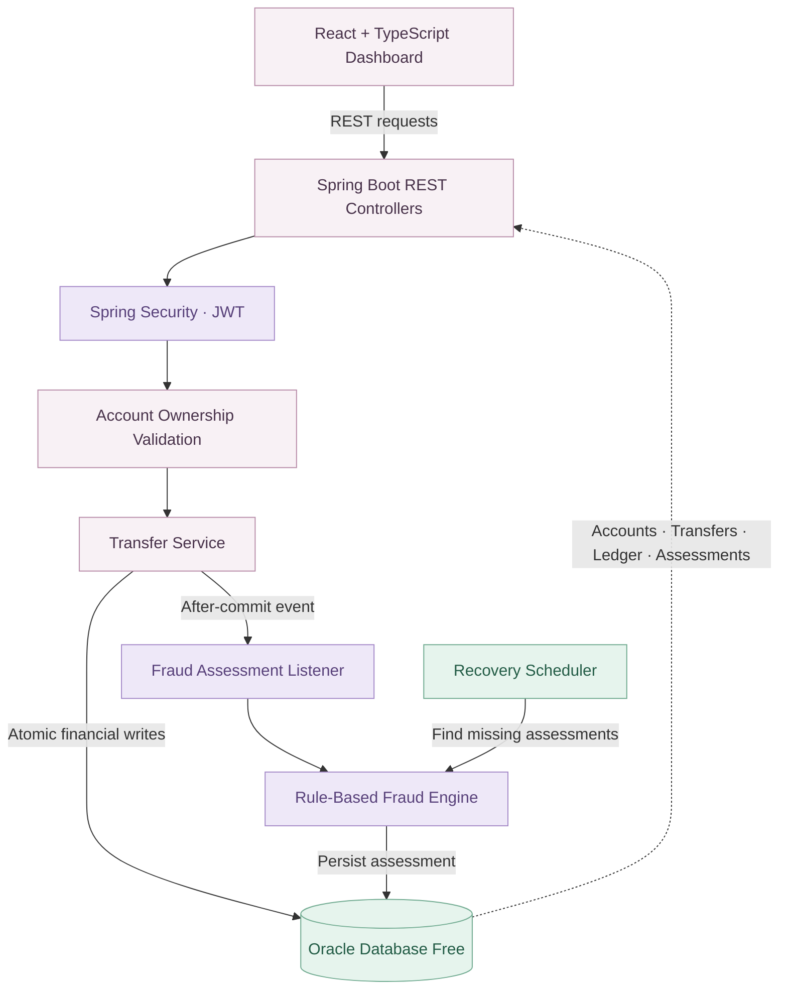
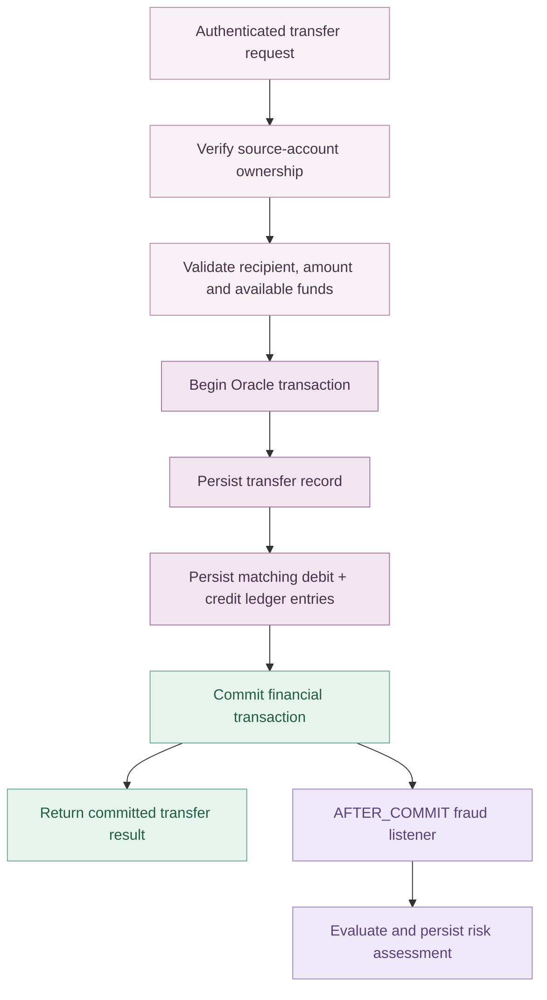
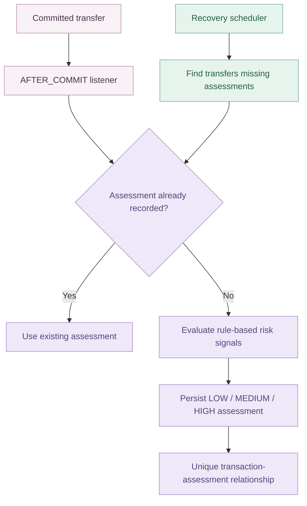

<div align="center">

# ORVENDIQ

### Secure Transactions. Traceable Ledgers. Explainable Risk.

**A full-stack fintech simulation built to explore the engineering behind financial transactions—not just the interface.**

Java 21 · Spring Boot · Oracle Database · React · TypeScript

[See the Product](#product-preview) · [Explore the Engineering](#engineering-decisions) · [System Architecture](#system-architecture) · [Run Locally](#run-locally)

</div>

---

## Beyond a transfer button

A transfer can look simple on screen. Behind that button are harder questions:

- **Authorization:** Can a user transfer funds from an account they do not own?
- **Consistency:** What happens if the transfer record is saved, but a ledger entry fails?
- **Auditability:** Can the account balance be reconstructed from financial entries?
- **Reliability:** What happens when risk assessment fails *after* the financial transaction commits?

**Orvendiq brings these concerns into one working full-stack portfolio project.** I built a Spring Boot API backed by Oracle Database and integrated it with an interactive React dashboard, focusing on transaction boundaries, account ownership, ledger integrity, and recoverable fraud assessment.

> **Project scope:** Educational fintech simulation using fictional demo data. It does not move real money, integrate with a bank, or claim production-grade fraud detection.

## Product preview

<table>
  <tr>
    <td width="50%">
      <strong>01 · Secure sign-in</strong><br>
      <sub>JWT-backed login connected to Spring Security.</sub><br><br>
      
    </td>
    <td width="50%">
      <strong>02 · Overview</strong><br>
      <sub>Account balances, recent activity, and live risk signals.</sub><br><br>
      
    </td>
  </tr>
  <tr>
    <td width="50%">
      <strong>03 · Money transfers</strong><br>
      <sub>Transfer interface backed by authorization and validation.</sub><br><br>
      
    </td>
    <td width="50%">
      <strong>04 · Transaction history</strong><br>
      <sub>Explore financial activity from authenticated API responses.</sub><br><br>
      
    </td>
  </tr>
</table>

**05 · Fraud analytics** — Review rule-based risk classifications and transaction assessment details.


---

## Engineering decisions

### 01 · Double-entry accounting instead of a single balance update

A successful transfer posts a financial transaction together with **a debit and a credit ledger entry**. The writes share an Oracle transaction boundary, so an error in posting is intended to roll back the financial operation rather than leave half a transfer recorded.

**What this demonstrates:**

- A traceable record of financial movements, not just a success response.
- Ledger-derived balance calculations and debit/credit consistency checks.
- Validation of available funds and the transfer request before posting.
- Explicit database transaction boundaries using Spring.

**Engineering takeaway:** Financial correctness depends on what is committed to the ledger, not what the interface says happened.

### 02 · Account ownership is a backend decision

JWT authentication identifies the caller, but **authentication alone does not authorize access to an arbitrary account**. Orvendiq checks the authenticated user's relationship to the source account through `USER_ACCOUNTS` before protected financial operations. Passwords are stored using BCrypt hashes.

**Engineering takeaway:** A disabled frontend button is not access control. The API must enforce the authorization boundary itself.

### 03 · Financial posting and fraud assessment have different failure boundaries

Orvendiq commits the financial transfer first and invokes fraud assessment via a Spring **`AFTER_COMMIT` event listener**. A rule-based engine evaluates signals such as transaction amount, frequency, and recipient history, producing **LOW / MEDIUM / HIGH** risk levels.

A recovery scheduler can revisit committed transfers whose assessment is missing. Idempotency logic and a database uniqueness constraint on the associated transaction help guard against duplicates.

**Trade-off:** Assessment can temporarily lag behind a committed transfer. This is a deliberate separation of responsibilities, not a guarantee that every assessment completes immediately. Risk output is informational, not proof of fraud or safety.

### 04 · A frontend that exercises actual backend workflows

The React + TypeScript dashboard consumes the Spring Boot API for login, transfers, balances, history, and fraud details. Selected panels refresh periodically. Tailwind CSS, GSAP, Motion, and Lenis support a responsive, animated interface without moving financial validation to the client.

---

## System architecture



The diagram is a logical component view. The after-commit listener is an application event mechanism, **not a message broker or distributed queue**.

## A transfer, end to end



**Failure boundary:** The transfer and its ledger entries are committed atomically. Fraud assessment happens afterward and can be recovered separately; it does not retroactively undo the committed financial posting.

## Fraud assessment lifecycle



**Why this matters:** A post-commit failure should not silently erase the financial record. Recovery and idempotency address the reliability gap between posting a transaction and recording its risk assessment.

---

## Technology stack

| Layer | Technologies | Engineering responsibility |
|:--|:--|:--|
| Backend | Java 21, Spring Boot, Spring Security | REST API, domain services, authentication, authorization |
| Data | Oracle Database Free, SQL, Spring Data JPA, Hibernate, JDBC | Transactions, ledgers, accounts, fraud assessments |
| Frontend | React, TypeScript, Vite, Tailwind CSS | Responsive, API-driven dashboard |
| Interaction | GSAP, Motion, Lenis | Interface transitions and scrolling |
| Tests | JUnit 5, Mockito | Domain rules, service behavior, integration scenarios |
| Local infrastructure | Docker | Oracle development environment |

## API highlights

| Method | Endpoint | Purpose |
|:--|:--|:--|
| `POST` | `/api/v1/auth/login` | Authenticate and obtain a JWT |
| `POST` | `/api/v1/transfers` | Submit an authorized account transfer |
| `GET` | `/api/v1/transactions` | Retrieve permitted transaction history |
| `GET` | `/api/v1/accounts/{accountNumber}/balance` | Retrieve an account balance |
| `GET` | `/api/v1/fraud/assessments/{id}` | Read an assessment subject to authorization |
| `GET` | `/api/v1/system/status` | Application status |

Protected routes rely on backend authorization, not just UI navigation checks.

## Testing the hard parts

The backend includes unit and integration tests addressing transfer authorization, funds validation, ledger integrity, rule boundaries, duplicate assessments, recovery, and transaction edge cases.

| Scenario | Behavior under test |
|:--|:--|
| Unauthorized source account | Ownership validation before an outgoing transfer |
| Insufficient funds | Reject posting rather than committing an invalid transfer |
| Transfer persistence | Correct debit and credit ledger records |
| Fraud evaluation | Risk rule behavior and classification thresholds |
| Repeated assessment | Idempotency and transaction uniqueness |
| Missing assessment | Post-commit recovery path |

Run selected fraud-focused tests on Windows:

```powershell
cd backend
.\mvnw.cmd "-Dtest=FraudRiskEngineTest,FraudRiskBoundaryTest,TransferFraudListenerTest" test
```

**Testing note:** These scenarios exist in the test suite; this README does not claim a universal pass rate. Some Oracle-backed integration tests can modify data and should run against a dedicated test database, not a demo environment you want to preserve.

## Run locally

**Requirements:** Java 21, Node.js/npm, Oracle Database Free, and an initialized Oracle application schema. Docker can host Oracle locally.

1. Configure the Oracle connection as described in `backend/src/main/resources/application.yaml` and supply secrets through environment variables, not committed files:

   ```text
   ORVENDIQ_DB_PASSWORD
   ORVENDIQ_JWT_SECRET
   ```

2. Start the backend from its directory:

   ```powershell
   cd backend
   .\mvnw.cmd spring-boot:run
   ```

3. In a separate terminal, start the frontend:

   ```powershell
   cd frontend
   npm install
   npm run dev
   ```

The Vite development server typically runs at `http://localhost:5173`; local API requests depend on the Vite proxy and Spring Boot service configuration.

**Build commands:**

```powershell
# Inside backend/
.\mvnw.cmd clean package -DskipTests

# Inside frontend/
npm run build
```

For component-specific details, visit [Backend documentation](backend/README.md) and [Frontend documentation](frontend/README.md).

## Repository structure

```text
Orvendiq/
├── backend/                  # Spring Boot API, services, persistence, tests
├── frontend/                 # React dashboard and API integration
├── docs/
│   └── screenshots/          # Product walkthrough images
├── .gitignore
└── README.md
```

## What I learned and what comes next

**Core competencies demonstrated:** financial-domain modeling, transaction integrity, account-level security, asynchronous side effects, failure recovery, automated testing, and full-stack API integration.

**Known limitations and opportunities:**

- This is not production banking infrastructure and has no real-money integrations.
- Fraud classification is heuristic, not a trained or independently validated ML detection model.
- Automated CI/CD, reproducible database provisioning, monitoring, rate limiting, and deeper security reviews are natural future improvements.
- Fraud assessment is eventually available after posting; the UI must tolerate an assessment that has not yet arrived.

---

<div align="center">

### Built by Dwi Nisyatul Wardah

**Information Technology Graduate · Backend & Full-Stack Development**

[GitHub Profile](https://github.com/dnwardah-dev) · [Backend](backend/) · [Frontend](frontend/)

<sub>Orvendiq is an educational simulation. All demo financial data is fictional.</sub>

</div>
